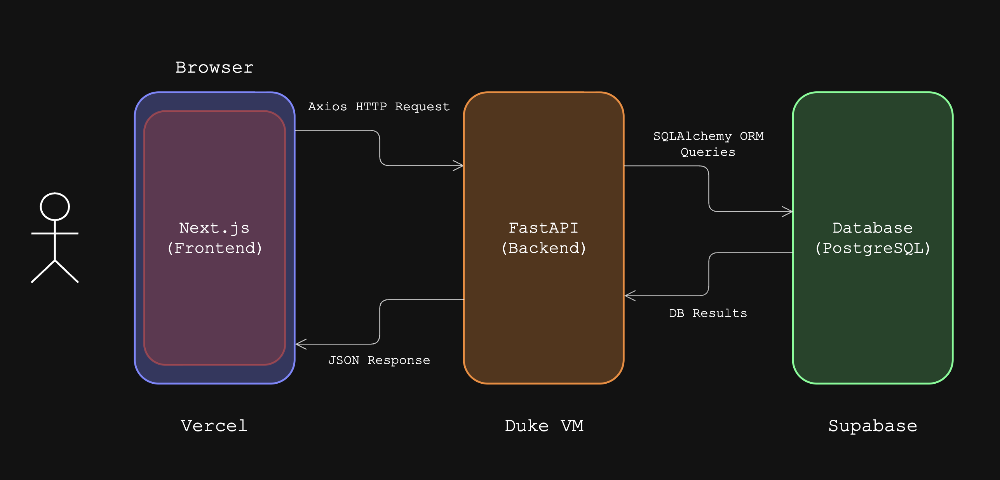
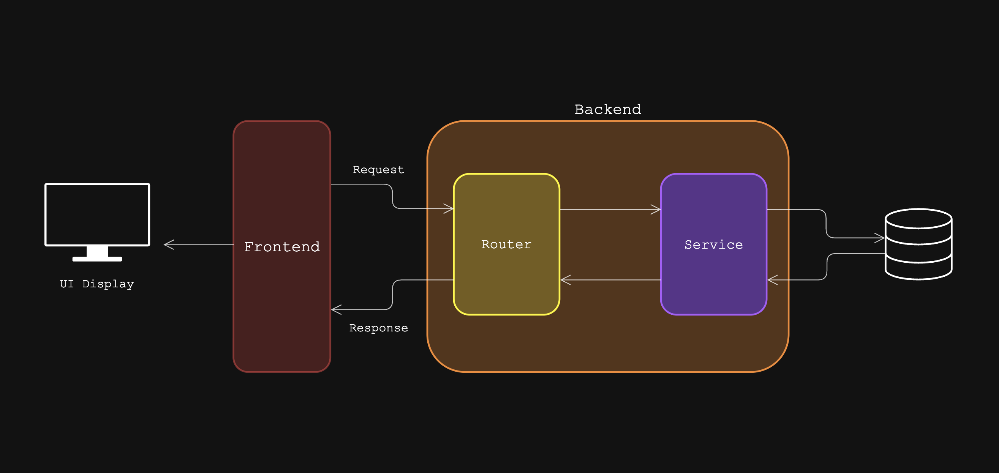

# Technical Reference Sheet
## Table of Contents
- [Tech Stack Summary](#tech-stack-summary)
- [Architecture Overview](#architecture-overview)
  - [System Diagram](#system-diagram)
  - [Folder Structure](#folder-structure-overview)
  - [Request Flow: Worked Example](#worked-example)
- [Testing Tutorial](#testing-tutorial)
- [Known Issues & Limitations](#known-issues--limitations)

## Tech Stack Summary
- **Frontend:** Next.js 16 (App Router), React 19, Typescript, Tailwind v4, shadcn/ui, MUI
  - **Hosting:** Vercel
- **Backend:** FastAPI (Python), SQLAlchemy ORM (no raw SQL), Pydantic for config/validation
  - **Hosting:** Duke VCM Virtual Machine
- **Testing:**
  - **Backend Testing:** pytest, with unit/ and integration/ suites
  - **Frontend Testing:** Vitest (not used yet)
- **Database:** PostgreSQL
  - **Hosting:** Supabase
- **CI/CD:** GitHub Actions
  > - Tests and builds run automatically on pushes and pull request to main
  > - Deploys to Vercel (frontend) and the Duke VM (backend) are handled by GitHub Actions, but require manual approval


## Architecture Overview
### System Diagram



### Folder Structure Overview
**Others:** (`/` directory)
```
.github/workflows/          — GitHub Actions definitions for automation (e.g. outlines how to tests, build, deploy)
backend/                    — FastAPI backend (see Backend breakdown below)
db/                         — SQL files for the database schema and seed data
docs/                       — deployment and architecture documentation
frontend/                   — Next.js frontend (see Frontend breakdown below)
.gitattributes              — git config for how files are handled (e.g. line endings)
.gitignore                  — defines which files/folders git should not track
CONTRIBUTING.md             — how to report issues, request features, and contribute
README.md                   — project overview, quick start, and contact info
```

**Backend:** (`/backend` directory)
```
backend/
  app/
    core/                    - shared constants that many parts of the app may depend on
    db/                      — SQLAlchemy engine/session DB setup
    models/                  — SQLAlchemy models for DB tables
    routers/                 — FastAPI endpoint definitions
    services/                - functions that support router endpoints (e.g., `create_event()` in `service_events.py`)
    testing/                 — pytest tests
      unit/                  — tests that DON'T require DB integration
      integration/           — test that require integration
    utils/                   - helper functions used by services/ (e.g., formatting, calculations)
    config.py                — settings for FastAPI app (backend) loaded from .env
  main.py                    — FastAPI backend instantiation
  pytest.ini                 — pytest's configuration that tells pytest how to run tests in this project
  requirements.txt           — lists the projects Python package dependencies
  testing_suites/            - holds different testing suites
  update.sh                  — script that pulls latest code and restarts the systemd service (the deployed backend)
```
**Frontend:** (`/frontend` directory)
```
frontend/
  public/                      - static assets referenced by URL (currently primarily images)
  src/                         - all frontend source code
    app/                       — Next.js App Router pages (events/, playbook/, etc.)
      @modal                   - parallel route for modal overlays
      admin/, events/, ...     — route folders each with one page.tsx per section
      globals.css               - site-wide styles (primarily global themes and custom animations)
      layout.tsx               - wraps every page and sets site metadata, loads fonts, and nests all app-wide providers
      page.tsx                 - the page UI for a given route (here is the homepage)
    assets/                    - static assets referenced by importing the (currently primarily icons)
    components/                — reusable, shared UI components (buttons, cards, etc.)
    contexts/                  - React Context providers for data shared across components
    hooks/                     - reuasble custom React hooks
    lib/                       - helper/utility functions that don't require React logic
```

### Worked Example
**Displaying announcements on homepage**

> Note:
> - All paths in frontend sections are assumed to be prefixed with `frontend/src/`
> - All paths in backend sections are assumed to be prefixed with `backend/`

1. **Frontend — request:** `app/page.tsx` renders `components/AnnouncementContainer.tsx`, which calls `api.get("/announcements/")`, sending an HTTP request to the backend.
2. **Backend — router:** `app/routers/announcements.py`'s `get_announcements_endpoint()` receives the request and calls the service function `get_announcements()`.
3. **Backend — service:** `app/services/service_announcements.py`'s `get_announcements()` queries the database for unexpired announcements, ordered by creation time, and returns the results to the router.
4. **Backend — response:** The router returns these results, and FastAPI turns them into a JSON response (a list of announcements) and sends it back to the frontend.
5. **Frontend — display:** `components/AnnouncementContainer.tsx` receives the JSON response, splits the announcements into pinned and unpinned lists, and renders each using `components/Announcement.tsx`.



## Testing Tutorial
### Backend

Tests live in `backend/app/testing/`, split into `unit/` (don't require the database) and `integration/` (require database access). Tests should ran in a specific order where smaller, fundamental tests run first, and then the larger tests that depend on the smaller ones. That way, if a bigger test fails (like a full endpoint test), you already know whether the pieces it depends on (its service function, its utility functions) are actually working. The `backend/testing_suites/` folder holds `.txt` files listing test file paths in the necessary order. 

> Additional notes on file structure:
> ```
> backend/app/testing/                 
>   unit/                              — tests that don't require the database
>   integration/                       — tests that require the database
>     queries/                         - tests for direct db querying that don't require additional computational logic
>     services/                        - tests for each service function counterpart
>     endpoints/                       - http tests for each endpoint function counterpart (uses FastAPI's TestClient class)
>   conftest.py                        - builds a fresh test database once per session and gives each test an isolated DB session and test client
> ```

**Running the test suites**

From `backend/`, with your virtual environment activated:

- macOS/Linux (Bash):
```bash
cat testing_suites/events_testing_suite.txt testing_suites/announcements_testing_suite.txt | xargs pytest
```

- Windows (PowerShell):
```powershell
pytest (Get-Content testing_suites/events_testing_suite.txt, testing_suites/announcements_testing_suite.txt)
```

**Adding a new test**

| Testing | Folder Location | Fixture needed? |
|---|---|---|
| Something that doesn't touch the database | `unit/` | None |
| A service function directly against the database | `integration/queries/` or `integration/services/` | `db_session` |
| An actual API route | `integration/endpoints/` | `client` |

Then add the new test's file path to whichever `testing_suites/*.txt` file it belongs to, placed after any tests it depends on.

## Known Issues & Limitations

### Current Constraints

1. The backend is hosted on a Duke VM that expires at the end of each semester, requiring it to be re-provisioned each term (see [Current Deployment](DEPLOYMENT.md)). The VM is also limited to 4.0 GB RAM, 2 processors, and 50 GB disk space.
2. The frontend is hosted on Vercel's free (Hobby) plan, which has usage limits that could potentially become a constraint as the app grows.
3. Only backend tests have been written so far. Frontend unit tests (planned: Vitest) and end-to-end tests (planned: Playwright) haven't been started yet.
4. User authentication has not been implemented. The plan is to use Duke's SSO rather than build custom auth, pending confirmation that's feasible. Because of this, user-specific features (current user, personal profiles) are currently built against a hardcoded test user rather than real session data.
5. Exec-only restrictions currently only exist on the frontend (conditionally rendering components and redirecting away from pages like `executive-tools` based on `isExec` in the user context) — there's no backend enforcement yet, since that depends on authentication being implemented first.
6. There's no database migration tooling in place; schema changes are applied by running SQL directly against Supabase. This is considered acceptable for now since the database is likely to be wiped and reseeded again during development anyway.
7. Only the homepage is responsive across screen sizes. Every other page has only been built and tested for desktop/laptop screens and likely looks broken on smaller screens.

### Incomplete Features

8. RSVP is not implemented on the backend — the database tables exist and the frontend has been built against the expected response shape (to test how the components should look), but nothing is connected yet.
9. Roster and Playbook pages have frontend and database tables, but no backend logic yet. Roster creation also depends on user creation, which isn't possible until authentication is implemented. Playbook images are currently sitting in `frontend/public/`, but long-term image storage (cloud storage, Google Drive, AWS) hasn't been decided yet.
10. Travel and lodging logistics are not yet implemented — database schema exists and some frontend work has started, but backend logic hasn't been built yet.
